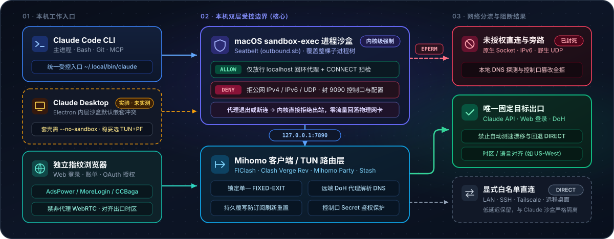

# Claude Local Onboard

> 面向 Codex / Claude Code 等 Agent 的 macOS 本机 Claude Code 环境搭建、内核级防泄漏加固与长期维护 Skill。

[](LICENSE)
-blue)


只开系统代理或只设 `HTTPS_PROXY` 环境变量，拦不住子进程原生直连、UDP/WebRTC 旁路，也挡不住代理客户端意外退出后的静默回落直连。**Claude Local Onboard** 让你的 Agent 按标准化 7 阶段流程，在任意 Mac（Apple Silicon 或 Intel）上搭出一套**双层防泄漏、代理断连即阻断（fail-closed）、可实测验收、可随时回退**的本地工作环境。

<p align="center">
  
</p>

---

## 适用边界

本 skill 只用于降低本机 Claude Code 接入环境的泄漏风险：代理/TUN、DNS、IPv6、WebRTC、进程旁路、工具输出等。

它不提供账号注册、订阅购买、KYC/身份验证、Claude Desktop 正式支持、平台风控或封禁处理方面的帮助，也不承诺通过任何平台的风险检查；这些请按官方流程处理。（注：关于尝试用 `sandbox-exec` 或 `TUN + pf` 约束 Claude Desktop 的实验性机制分析［未实机验证］，收录在 [`seatbelt-and-launcher.md`](references/seatbelt-and-launcher.md) 供参考。）

---

## 核心设计：为什么它能防旁路、防断连回落

1. **进程级内核强制沙盒（`sandbox-exec`）**：不依赖程序“自觉读取代理变量”。通过 macOS 原生 Seatbelt 策略拦截 Claude Code 及所有子进程的非回环网络出站，直连公网 IPv4 / IPv6 / UDP 一律在内核层返回 `EPERM`；同时封禁代理管理端口与订阅配置文件读取。
2. **启动前预检 + 代理停机 fail-closed**：统一入口 `~/.local/bin/claude` 启动前先对本地代理发起 `CONNECT` 预检；运行期间哪怕代理客户端崩溃或 TUN 网卡消失，流量也立即阻断而绝不回落物理网卡直连。
3. **单一固定出口 + 日常工作流共存**：通过 Mihomo 持久覆写锁定单一稳定节点，防止订阅更新冲掉规则或自动测速跨区乱跳；同时显式放行局域网、SSH、Tailscale 等 Mesh VPN 与远程桌面。
4. **全工具链可替换，无绑定锁死**：Apple Silicon 与 Intel Mac 均支持；代理客户端、指纹浏览器均可按手头工具自由组合。

---

## 快速开始

把下面这段直接发给你的 Agent（建议首次清理与安装阶段在 **Codex** 或独立辅助 Agent 中运行，避免正在运行的 Claude Code 清理或重装自身）：

```text
安装并阅读 skill：
https://github.com/lavapapa/claude-local-onboard

按该 skill 帮我在本机搭建并验收 Claude Code 运行环境。
```

Agent 会先做无副作用只读盘点，向你确认期望出口地区（如美国加利福尼亚 `America/Los_Angeles`）、设备固定/移动形态、需保留的日常直连访问与旧数据备份方式，再逐阶段推进。登录、验证码、系统授权与订阅导入全程由你在本机界面亲自操作。

---

## 灵活可选的工具链

| 层级 | 可选工具（任选其一即可） | 职责 |
|---|---|---|
| **代理与路由层** | FlClash / Clash Verge Rev / Mihomo Party / Stash / 裸 `mihomo` | 提供本地统一混合端口、TUN 接管、DoH 代理解析、固定出口组与直连白名单 |
| **进程强制沙盒层** | macOS 原生 `/usr/bin/sandbox-exec` + 受控启动包装器 | 内核态阻断非回环公网连接、屏蔽代理控制口、实现代理停机 fail-closed |
| **隔离浏览器层** | AdsPower / MoreLogin / CCBaga / 独立 Chromium `--user-data-dir` | 隔离 Web 登录 Cookie 与缓存、收敛 WebRTC/QUIC、绑定本地同一代理端口 |
| **环境一致性层** | 浏览器 Profile + CLI `TZ`/`LANG`（可选同步 macOS `systemsetup`） | 对齐出口地区的时区、语言与定位权限，全部保留原值回退命令 |

---

## 7 阶段执行与验收流程

| 阶段 | 核心动作 | 过关门槛 |
|---|---|---|
| **1. 盘点与定方案** | 只读盘点系统、网络、残留文件与进程，选定网络模式（推荐 TUN + `sandbox-exec`，移动本可选纯端口 + `sandbox-exec`） | 输出脱敏现状摘要，确认备份与回退前提 |
| **2. 备份与清旧环境** | 完整归档旧配置/会话并校验可读，按确认范围清理 `~/.claude`、`~/.claude.json` 与冲突残留 | 备份可读，新环境目录干净独立 |
| **3. 固定出口与白名单** | 写入持久覆写配置：统一代理端口、控制口加 Secret、锁定 `FIXED-EXIT`、配置代理解析 DNS 与日常直连白名单 | 出口地区稳定一致，订阅刷新不覆盖规则 |
| **4. 隔离浏览器与环境对齐** | 配置独立指纹浏览器绑定本地代理，关闭非代理 WebRTC UDP，对齐目标出口时区与语言（如 `America/Los_Angeles`） | 浏览器与预设时区/语言一致，无定位泄露 |
| **5. 部署 `sandbox-exec` 启动链** | 官方安装 Claude Code，部署 `outbound.sb`、`claude-network-run` 与 `~/.local/bin/claude` 受控包装器 | `PATH` 唯一命中受控入口，直连自检返回 `EPERM` |
| **6. 登录前预验收与故障注入** | 未登录状态下实测出口、DNS、IPv6、WebRTC、管理口封禁及**受控停代理 fail-closed 阻断测试** | 停代理时严格阻断不直连，日常保留网络正常 |
| **7. 登录终验与交付恢复卡** | 用户亲自登录授权，验证真实 CLI 进程 `sandbox_check` 受限生效，输出脱敏证据表与一键恢复卡片 | 全部必需项达标，恢复步骤清晰可用 |

首次接入完成后，后续版本更新、配置调整、工具输出脱敏边界与多账号维护可直接让 Agent 按 `references/ongoing-maintenance.md` 执行巡检。

---

## 仓库结构

```text
claude-local-onboard/
├── SKILL.md                                 # Agent 主引导流程与阶段门禁
├── README.md                                # 项目说明与快速上手
├── CONTRIBUTING.md                          # 贡献与实机验证规范
├── LICENSE                                  # MIT License
├── assets/
│   └── hero-architecture.svg                # 双层受控架构矢量总览图
└── references/                              # Agent 按阶段按需读取的技术参考
    ├── signals-and-architecture.md          # 信号暴露模型与模式 A/B/C 架构对比
    ├── preflight-and-cleanup.md             # 只读盘点、Claude 本机路径全表与备份清理
    ├── egress-and-tun.md                    # Mihomo TUN、持久覆写 YAML 骨架与直连白名单
    ├── seatbelt-and-launcher.md             # sandbox-exec (outbound.sb) 与受控启动器模板
    ├── browser-and-locale.md                # 独立指纹浏览器选型与时区/语言对齐方法
    ├── acceptance-and-delivery.md           # 内核阻断探针、停代理测试、脱敏摘要与恢复卡
    └── ongoing-maintenance.md               # 接入后的长期维护、防漂移巡检与扩展边界
```

---

## 已知限制

- **仅支持 macOS**（依赖 macOS 原生 `/usr/bin/sandbox-exec`、`libsandbox`、`networksetup` / `systemsetup` 及 Mihomo TUN），Linux 与 Windows 不适用。
- **沙盒管出站，不管本地文件读取**：`sandbox-exec` 能彻底封死非回环网络直连，但如果会话允许执行任意本地 Shell 命令（如打印网卡信息进入对话），本地文本仍可能随 API 请求发出；缓解策略与边界详见 [接入后的长期维护](references/ongoing-maintenance.md)。
- **第三方 IP 库仅供参考**：IPinfo、Scamalytics、Mullvad Check 等站点只代表当次外部观测，不等同于平台内部判定逻辑。

## 问题反馈与贡献

遇到某一步在新版 macOS 或客户端上表现不一致，欢迎通过 Issue 模板提交 macOS 版本、芯片架构、工具版本与**脱敏后**的观测结果（切勿粘贴真实公网 IP、订阅链接、Token、Cookie 或账号信息）。贡献细则见 [CONTRIBUTING.md](CONTRIBUTING.md)。

## 许可

[MIT License](LICENSE)
